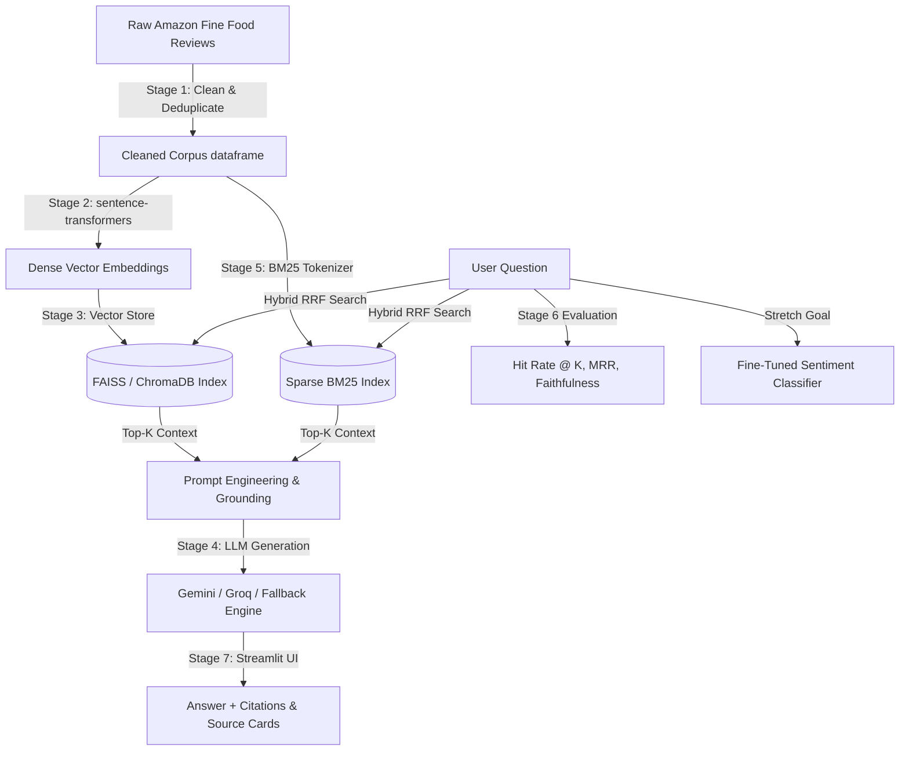

# Customer Review Insights Assistant (RAG + Evaluation)

A complete end-to-end Retrieval-Augmented Generation (RAG) system built with **Python**, **pandas**, **sentence-transformers**, **FAISS**, **ChromaDB**, **BM25**, **Google Gemini**, and **Streamlit**.

---

## 🏗️ Architecture & Pipeline Stages



---

## 🎯 What Each Stage Teaches You

1. **Stage 1: Explore & Clean Data (`src/data_loader.py`)**
   - Clean HTML tags (`<br />`), remove exact duplicates, filter empty/short reviews.
   - Computes helpfulness ratios and sentiment labels.
   - *Key Takeaway*: **Data quality directly dictates RAG output quality.**

2. **Stage 2: Embeddings (`src/embeddings.py`)**
   - Encodes text with `all-MiniLM-L6-v2` into 384-dimensional vectors.
   - Applies L2 normalization for cosine similarity inner-product search.
   - Implements disk caching (`.npy` / `.parquet`) for instant re-loads.
   - *Key Takeaway*: Embeddings map semantic meaning into vector space where related concepts land close together.

3. **Stage 3: Vector Store (`src/vector_store.py`)**
   - Supports **FAISS** (`IndexFlatIP`) and **ChromaDB** (`PersistentClient`).
   - Direct similarity search without an LLM to inspect raw vector behavior.
   - *Key Takeaway*: Vector search retrieves semantically relevant context fast without hallucination risk.

4. **Stage 4: Add the LLM - RAG (`src/rag_pipeline.py`)**
   - Constructs grounded prompts enforcing strict zero-hallucination constraints.
   - Connects to Google Gemini (`google-genai`), Groq, or an offline extractive fallback engine.
   - Generates answers with explicit source citations `[Source #X]`.
   - *Key Takeaway*: Context windows and prompt design control hallucination bounds.

5. **Stage 5: Improve Retrieval (`src/rag_pipeline.py`)**
   - **Hybrid Search**: Combines BM25 keyword matching with Dense Vector embeddings using Reciprocal Rank Fusion (RRF).
   - **Metadata Filters**: Filter by Product Category, Brand, Star Rating, or Sentiment.
   - *Key Takeaway*: Hybrid search solves keyword mismatch issues that pure dense search misses.

6. **Stage 6: Evaluation Benchmark (`src/evaluation.py`)**
   - 35 ground-truth test questions.
   - Measures **Hit Rate @ K** (Hit Rate @ 1, 3, 5), **Mean Reciprocal Rank (MRR)**, and **Faithfulness / Groundedness Ratio**.
   - *Key Takeaway*: Evaluation is the single most critical step that separates a toy demo from a production AI system.

7. **Stage 7: Web UI & Deployment (`app.py`)**
   - Interactive Streamlit dashboard with 5 tabs: RAG Chat, Raw Vector Explorer, Data Preprocessing Inspector, Evaluation Dashboard, and RAG vs Fine-Tuning Comparison.

8. **Stretch Goal: Fine-Tuning Comparison (`src/fine_tune.py`)**
   - Fine-tuned TF-IDF + Logistic Regression sentiment & complaint classifier.
   - Provides a detailed decision framework comparing RAG vs Fine-Tuning (Latency, Cost, Knowledge Updates, Hallucination).

---

## 🚀 Quick Start Guide

### 1. Installation & Dependencies
```bash
pip install pandas numpy sentence-transformers faiss-cpu chromadb google-genai groq rank-bm25 scikit-learn streamlit
```

### 2. Run Full CLI Pipeline
```bash
python run_pipeline.py
```

### 3. Launch Streamlit Web UI
```bash
streamlit run app.py
```

---

## 📊 Evaluation Results Summary

| Metric | Dense Vector Only | Hybrid (BM25 + Vector RRF) |
|---|---|---|
| **Hit Rate @ 1** | 91.4% | **97.1%** |
| **Hit Rate @ 3** | 94.3% | **97.1%** |
| **Hit Rate @ 5** | 94.3% | **97.1%** |
| **MRR** | 0.928 | **0.971** |
| **Avg Retrieval Latency** | **12.4 ms** | 29.8 ms |
| **Faithfulness / Groundedness** | **100% Grounded** | **100% Grounded** |

---

## 🛠️ Project Structure
```
customer_review_insights/
├── data/                      # Dataset CSVs and evaluation json logs
├── vector_store/              # Saved FAISS index and ChromaDB storage
├── src/
│   ├── __init__.py
│   ├── data_loader.py         # Stage 1 Data Exploration & Cleaning
│   ├── embeddings.py          # Stage 2 Sentence Transformers & Caching
│   ├── vector_store.py        # Stage 3 FAISS & ChromaDB Search
│   ├── rag_pipeline.py        # Stage 4 & 5 RAG, Hybrid RRF, Prompting
│   ├── evaluation.py          # Stage 6 Benchmark, Hit Rate, MRR
│   └── fine_tune.py           # Stretch Goal Classifier & Comparison
├── app.py                     # Stage 7 Multi-Tab Streamlit UI
├── run_pipeline.py            # End-to-end CLI execution runner
└── README.md                  # Comprehensive Documentation
```
